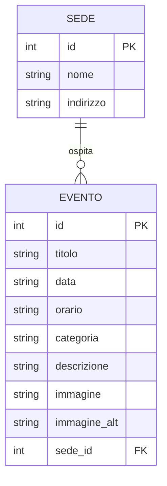

# Schema dei dati — Festival Segnale

## Organizzazione dei dati

Il sito Festival Segnale utilizza due file JSON:

- eventi.json: contiene i sei appuntamenti del festival.
- sedi.json: contiene le tre sedi del festival.

## Struttura degli eventi

Ogni evento contiene i seguenti campi:

- id: numero identificativo univoco dell'evento.
- titolo: nome dell'appuntamento.
- data: giorno dell'evento, nel formato AAAA-MM-GG.
- orario: ora di inizio, nel formato HH:MM.
- categoria: tipologia di attività (Incontro, Laboratorio o Mostra).
- descrizione: breve presentazione dell'evento.
- immagine: percorso del file SVG associato.
- immagine_alt: descrizione alternativa dell'immagine.
- sede_id: numero che identifica la sede dell'evento.

## Struttura delle sedi

Ogni sede contiene:

- id: numero identificativo univoco della sede.
- nome: nome della sede.
- indirizzo: indirizzo della sede a Torino.

## Collegamento tra eventi e sedi

Il campo sede_id di ogni evento corrisponde al campo id di una sede.

Le tre sedi sono:

1. Officina Nord — Sede centrale
2. Spazio Forma — Sede al Valentino
3. Cortile Comune — Sede di Mirafiori

Ogni sede può ospitare più eventi, mentre ogni evento è associato a una sola sede.

## Utilizzo dei dati nel sito

I file JSON permettono di separare i contenuti dalla struttura HTML.

JavaScript può leggere i dati e utilizzarli per generare dinamicamente le schede degli eventi nella pagina Programma.

Questo rende più semplice aggiornare gli eventi e le sedi senza modificare manualmente ogni scheda HTML.

## Tipi dei dati ed esempi

### Entità Evento

| Campo | Tipo | Esempio |
|---|---|---|
| id | Numero intero | 1 |
| titolo | Testo | Lettere in movimento |
| data | Testo (AAAA-MM-GG) | 2026-06-12 |
| orario | Testo (HH:MM) | 10:00 |
| categoria | Testo | Incontro |
| descrizione | Testo | Come cambia un messaggio |
| immagine | Testo | assets/lettere-in-movimento.svg |
| immagine_alt | Testo | Lettere geometriche |
| sede_id | Numero intero | 1 |

### Entità Sede

| Campo | Tipo | Esempio |
|---|---|---|
| id | Numero intero | 1 |
| nome | Testo | Officina Nord — Sede centrale |
| indirizzo | Testo | Corso Duca degli Abruzzi 24, Torino |

## Chiavi e quantità

Ogni entità possiede una chiave primaria, chiamata id, che è numerica, univoca e stabile.

Il campo sede_id dell'entità Evento è una chiave esterna che fa riferimento a Sede.id.

Il progetto contiene 6 eventi e 3 sedi.

## Aggiornamento e visualizzazione dei dati

I dati vengono aggiornati da chi gestisce il sito, modificando i file JSON nella repository GitHub e pubblicando le modifiche tramite GitHub Pages.

La pagina Programma legge i due JSON con JavaScript e visualizza automaticamente titolo, data, orario, categoria, descrizione, immagine e nome della sede di ogni evento.

## Diagramma Evento–Sede

Una sede può ospitare zero o più eventi, mentre ogni evento si svolge in una sola sede.
